# Exploratory Data Analysis with R — Milestone Deliverable

**Jacob Dudas | November 13, 2026**

**Course:** DS 201 — Principles of Data Science  
**Reading:** [R for Data Science (2nd edition), Chapter 10](https://r4ds.hadley.nz/EDA.html)  
**Assigned sections:** 10.3.3 (Questions 1–4) and 10.4.1 (Questions 1–3)

For this assignment, I used R to answer the seven questions and included graphs to support my answers. The full R code is available in [EDA_R.Rmd](EDA_R.Rmd).

---

## 10.3.3 Exercises — Variation (4 Questions)

### 10.3.3 — Question 1: Distributions of `x`, `y`, and `z`

**Question:** Explore the distribution of each of the `x`, `y`, and `z` variables in `diamonds`. What do you learn? Think about a diamond and how you might decide which dimension is the length, width, and depth?

I compared the three measurements and checked for unusual values.

| dimension | min_mm | median_mm | max_mm | number_equal_to_zero | number_over_20_mm |
|---|---|---|---|---|---|
| x | 0.00 | 5.70 | 10.74 | 8 | 0 |
| y | 0.00 | 5.71 | 58.90 | 7 | 2 |
| z | 0.00 | 3.53 | 31.80 | 20 | 1 |

**Distribution of Diamond Dimensions**

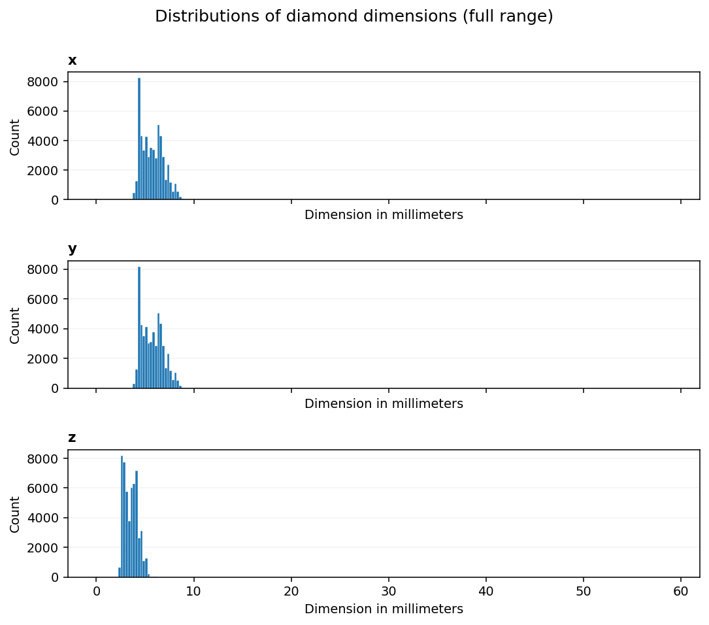

I also zoomed in to get a better look at the main group of measurements.

**Zoomed Distribution of Diamond Dimensions**

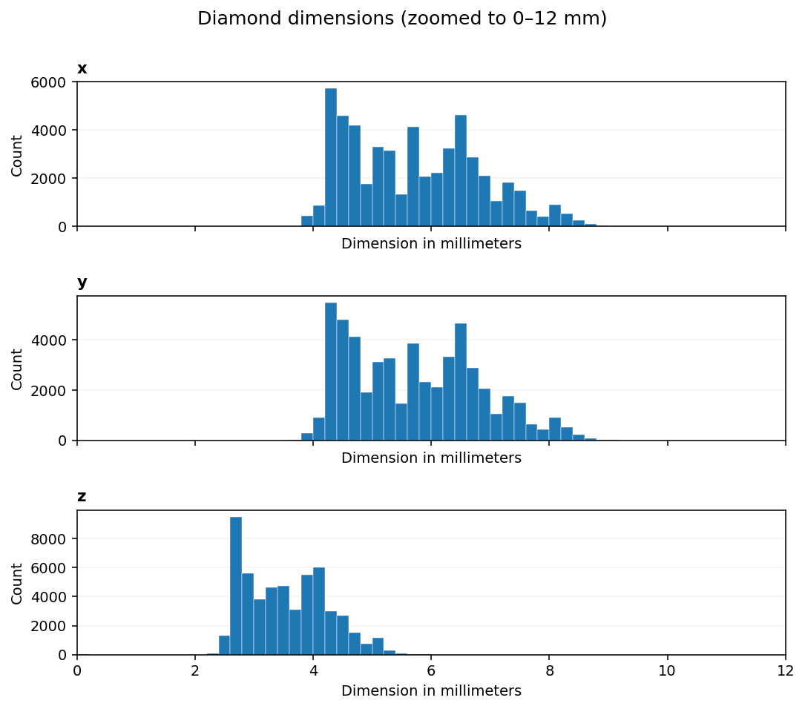

**Answer:** Based on the histograms, `x` and `y` have very similar measurements, while `z` is generally smaller. This makes sense because `x` and `y` represent the length and width, while `z` measures the depth of a diamond. I also found some measurements of zero and a few unusually large values, which likely indicate errors in the data.

---

### 10.3.3 — Question 2: Distribution of `price`

**Question:** Explore the distribution of `price`. Do you discover anything unusual or surprising? (Try a wide range of histogram `binwidth` values.)

I tried different bin widths to see how the price distribution changes.

**Diamond Prices — $1,000 Bin Width**

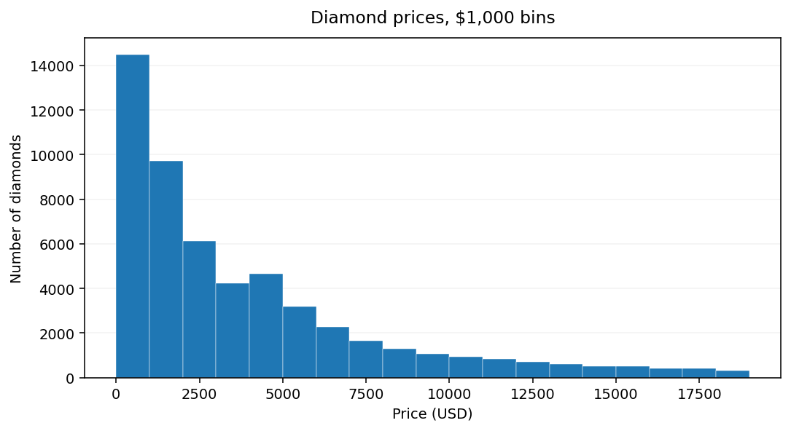

**Diamond Prices — $100 Bin Width**

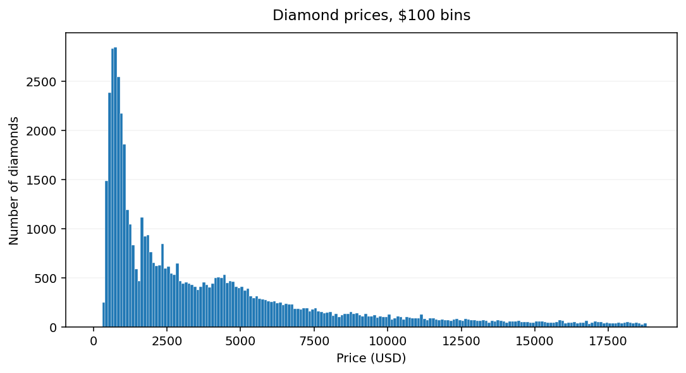

**Diamond Prices — $5 Bin Width**

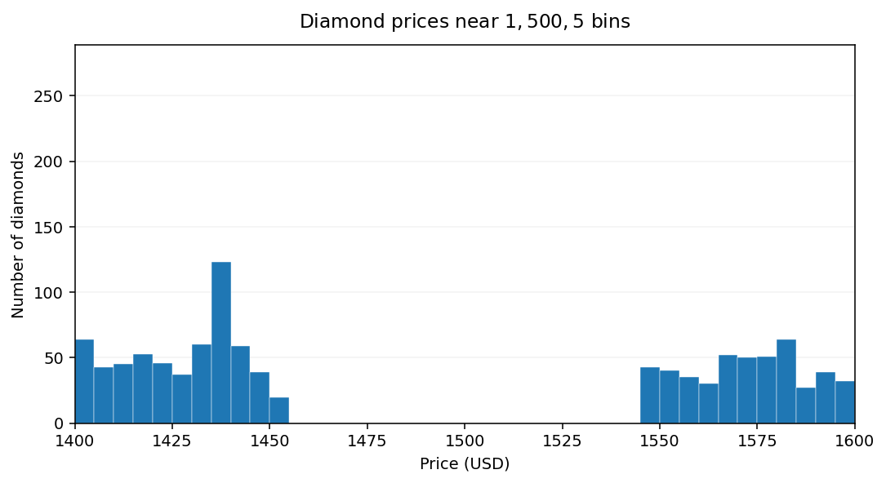

I also checked the prices in the gap.

| minimum_price | median_price | maximum_price | priced_1455_through_1545 |
|---|---|---|---|
| 326 | 2401 | 18823 | 0 |

**Answer:** Most diamonds are priced on the lower end, with fewer diamonds at higher prices. When I used smaller bin widths, I noticed there were no diamonds priced between $1,455 and $1,545. This shows how changing the bin width can reveal patterns that are harder to see with larger bins.

---

### 10.3.3 — Question 3: 0.99 Carat versus 1.00 Carat

**Question:** How many diamonds are 0.99 carat? How many are 1 carat? What do you think causes the difference?

| carat | number_of_diamonds |
|---|---|
| 0.99 | 23 |
| 1.00 | 1558 |

**Counts of Diamonds Near 1 Carat**

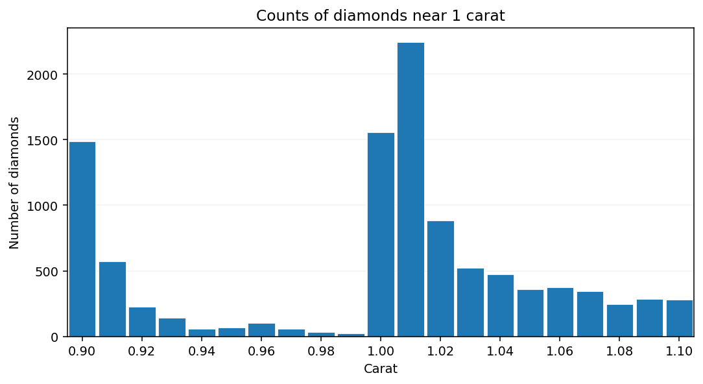

**Answer:** There are **23 diamonds at 0.99 carat** compared with **1,558 at 1.00 carat**. I think this is because 1 carat is an important selling point, so diamond cutters may try to keep the weight at or above that amount. However, the data alone cannot confirm this.

---

### 10.3.3 — Question 4: `coord_cartesian()` versus `xlim()` and `ylim()`

**Question:** Compare and contrast `coord_cartesian()` versus `xlim()` or `ylim()` when zooming in on a histogram. What happens if you leave `binwidth` unset? What happens if you try to zoom so only half a bar shows?

First, I compared the zooming methods using the same bin width.

**Plot 1: Using `coord_cartesian()`**

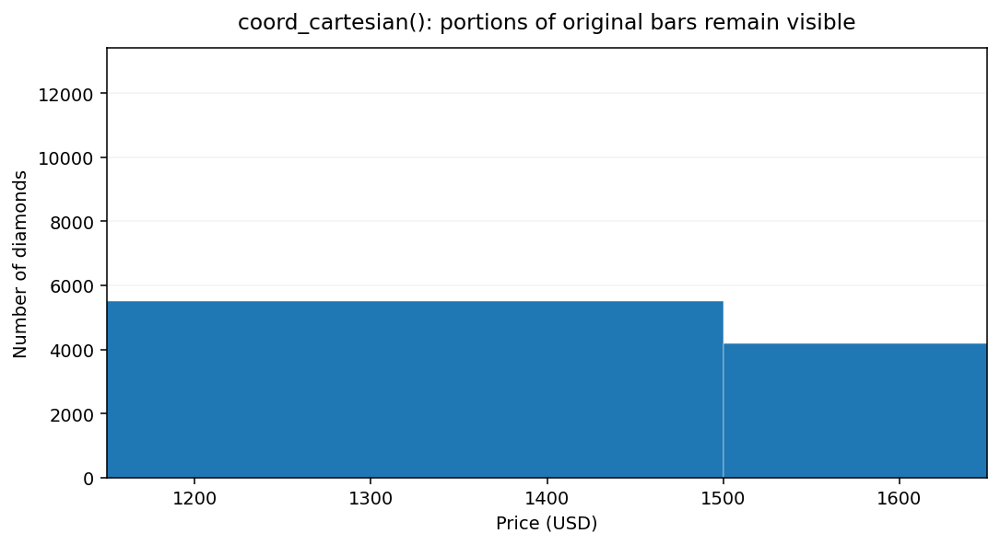

**Plot 2: Using `xlim()`**

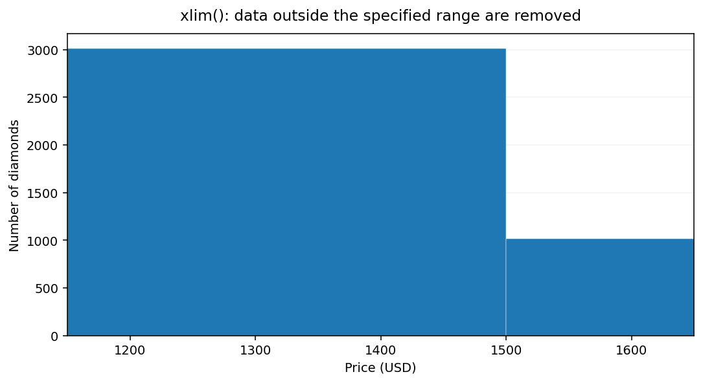

Next, I compared them without setting a bin width.

**Plot 3: Automatic Bins with `coord_cartesian()`**

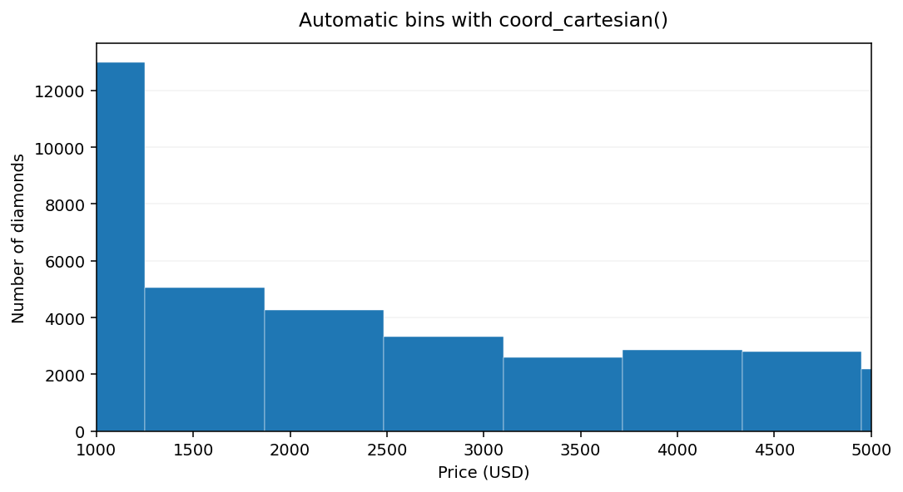

**Plot 4: Automatic Bins with `xlim()`**

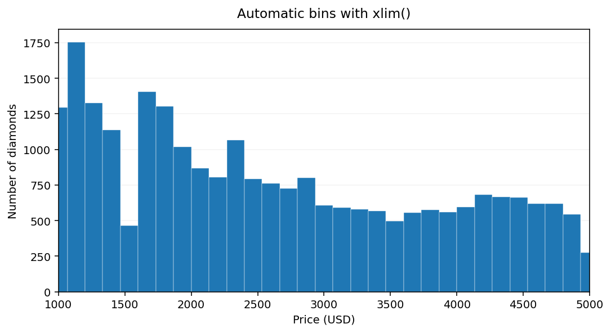

Finally, I compared what happens when zooming in on the y-axis.

**Plot 5: Y-Axis with `coord_cartesian()`**

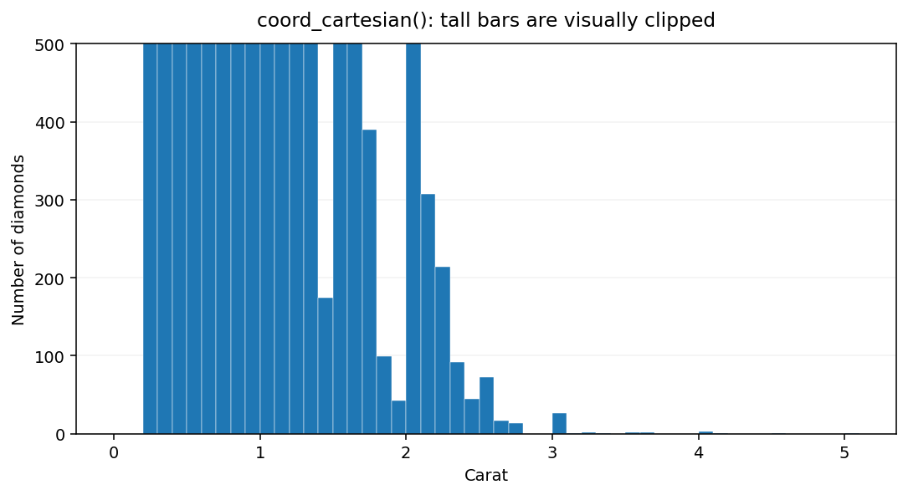

**Plot 6: Y-Axis with `ylim()`**

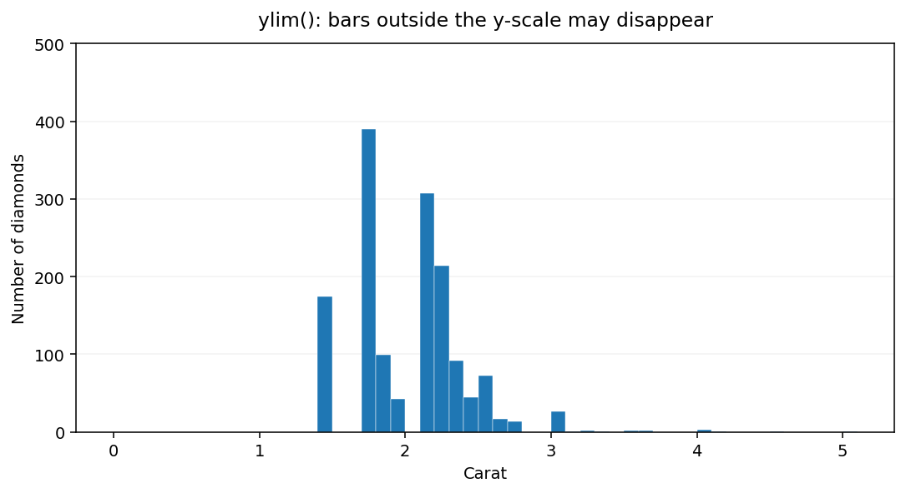

**Answer:** `coord_cartesian()` zooms in without removing any data, while `xlim()` and `ylim()` can remove observations or bars outside their limits. If I do not set `binwidth`, R automatically uses 30 bins, and using `xlim()` can change how those bins are calculated. If the zoom cuts through a bar, `coord_cartesian()` shows only the visible part of it. Therefore, I would use `coord_cartesian()` to zoom in without changing the original histogram.

---

## 10.4.1 Exercises — Unusual Values (3 Questions)

### 10.4.1 — Question 1: Missing Values in Histograms and Bar Charts

**Question:** What happens to missing values in a histogram? What happens to missing values in a bar chart? Why are they treated differently?

I used a small example with missing values to compare the graphs.

| missing_measurements | missing_categories |
|---|---|
| 1 | 1 |

| category | n |
|---|---|
| A | 2 |
| B | 2 |
| NA | 1 |

**Plot 1: Histogram with Missing Values**

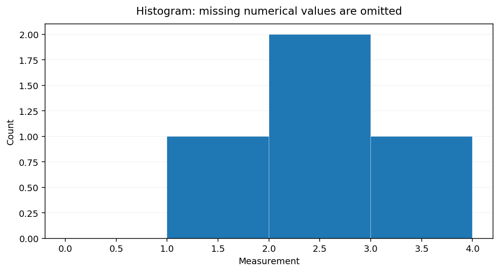

**Plot 2: Bar Chart with Missing Values**

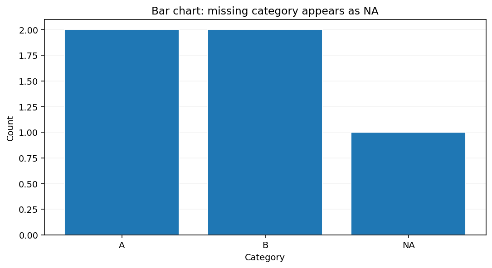

**Answer:** Histograms leave out missing values because an `NA` cannot be placed into a numerical range. Bar charts can show missing values as their own `NA` category. This is because histograms group numerical values into intervals, while bar charts count categories.

---

### 10.4.1 — Question 2: `na.rm = TRUE` in `mean()` and `sum()`

**Question:** What does `na.rm = TRUE` do in `mean()` and `sum()`?

**R Output:**

| Calculation | Result |
|---|---|
| mean(values) | NA |
| mean(values, na.rm = TRUE) | 4.666667 |
| sum(values) | NA |
| sum(values, na.rm = TRUE) | 14 |

**Answer:** Using `na.rm = TRUE` tells R to ignore missing values when calculating a mean or sum. Without it, both functions return `NA` in this example. When I use it, the mean is about **4.67** and the sum is **14**.

---

### 10.4.1 — Question 3: Scheduled Departure Times and Cancelled Flights

**Question:** Recreate the frequency plot of `scheduled_dep_time` colored by whether the flight was cancelled or not. Also facet by `cancelled`. Try different `scales` values to reduce the visual effect of the much larger non-cancelled group.

I converted the scheduled departure times to hours and labeled flights with missing departure times as cancelled.

**Plot 1: Scheduled Departure Times by Cancellation Status**

*Plot pending: this graph must be generated from the R Markdown file.*

**Plot 2: Faceted Departure Times with Fixed Scales**

*Plot pending: this graph must be generated from the R Markdown file.*

**Plot 3: Faceted Departure Times with Free Y-Axis Scales**

*Plot pending: this graph must be generated from the R Markdown file.*

**Plot 4: Faceted Departure Times with Both Scales Free**

*Plot pending: this graph must be generated from the R Markdown file.*

**Answer:** There are many more non-cancelled flights than cancelled flights, which makes the cancelled-flight pattern difficult to see. With `scales = "fixed"`, both graphs use the same scales, while `scales = "free_y"` gives each graph its own y-axis. I think `free_y` works best because it makes both patterns easier to see while keeping the time axis the same. However, the heights cannot be directly compared since the y-axes are different.
